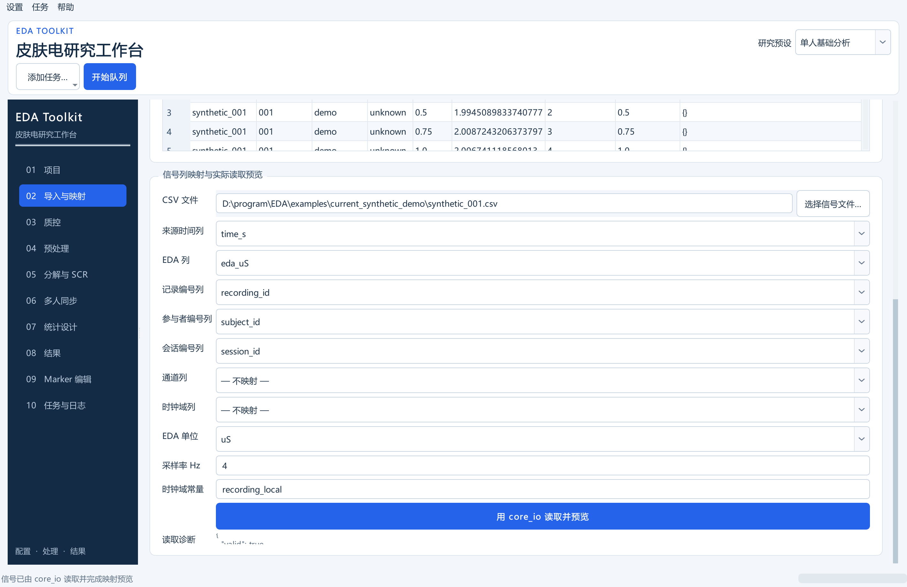
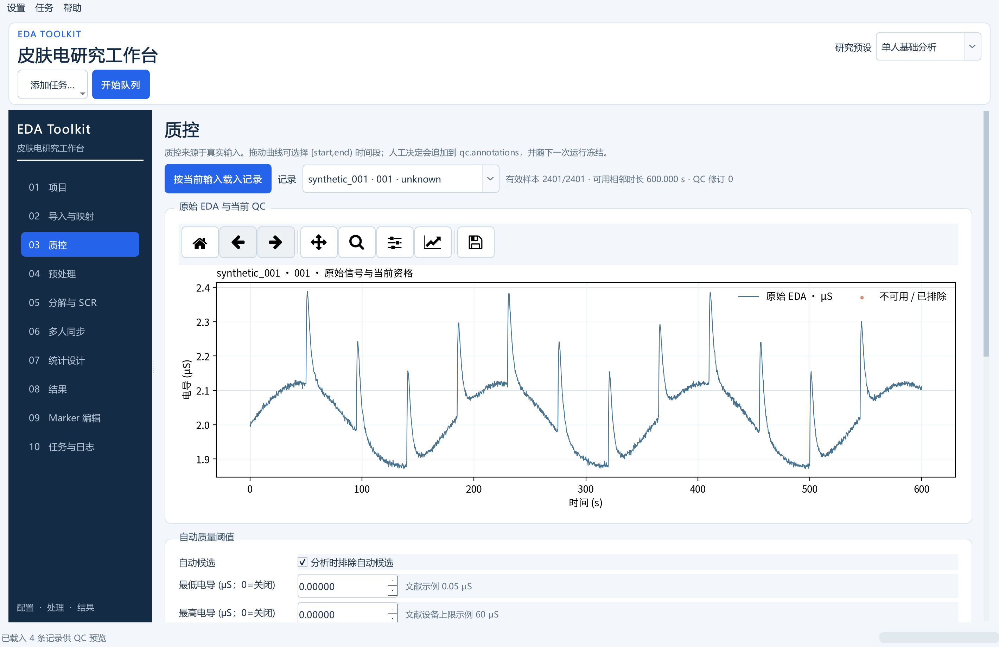
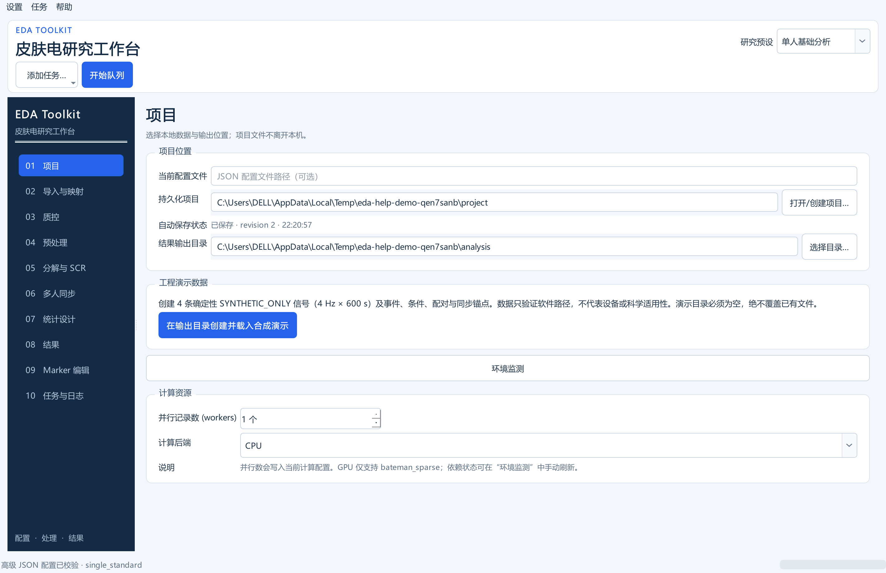
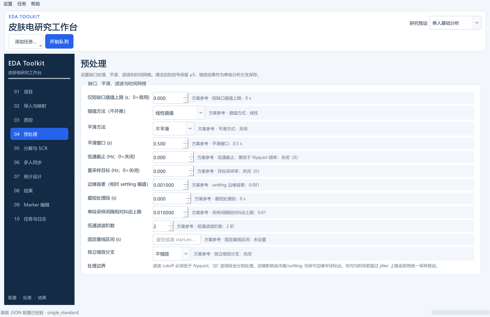
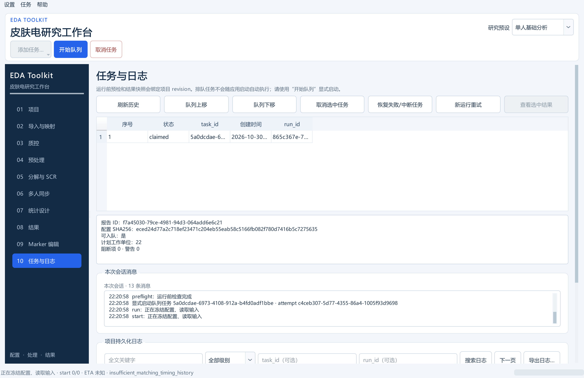
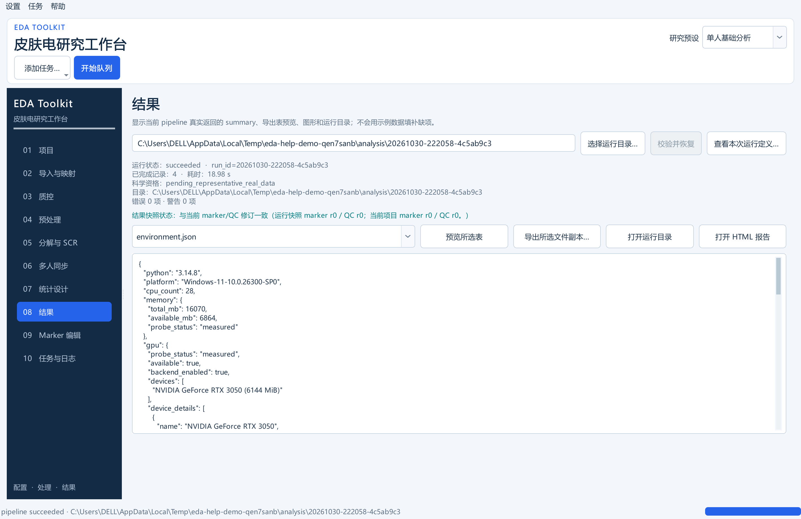
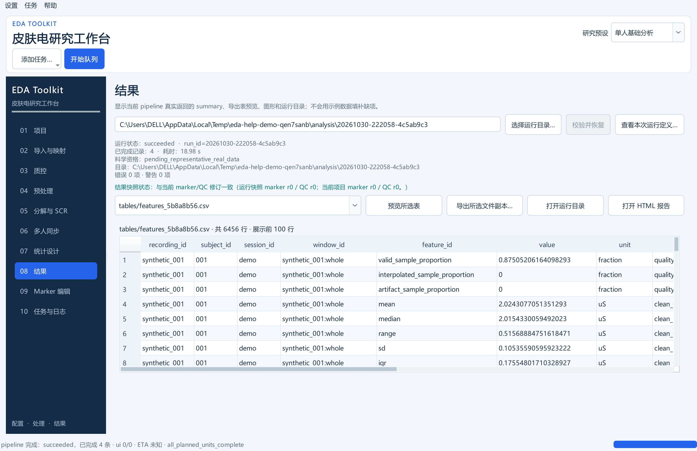

# 操作指南

适用 EDA Toolkit v0.3.1。图中为本版本界面的实际截图；演示记录是 SYNTHETIC_ONLY 合成数据，仅用于说明软件操作，不是研究结果。

## 1. 项目首页

选择输出目录、研究预设或 JSON 配置。首页提供合成演示入口和运行环境状态。合成演示只会创建到新目录，不覆盖既有文件。能力卡片显示当前环境可用的依赖和分析方法。

顶部“单文件试跑”“批量启动”“取消运行”可控制分析任务。运行期间界面会显示当前阶段、日志和进度；任务结束后可查看状态和结果。

## 2. 导入与映射

"导入与映射"页面有九类 CSV 模板，可查看模板、下载空表或选择已有文件。载入后会显示总行数和有限预览；完整字段格式、关联关系及时间来源检查仍会在校验和分析前执行，因此预览不能代替验证。

列映射预览只从实际文件表头填充列名。时间列、EDA 列、记录/参与者/会话/通道和时钟域由用户明确选择。自定义 EDA 列必须选单位；不清楚单位时不要猜。无时间列时填写采样率 Hz，且应声明来源时间单位。编码、分隔符及缺失标记可从完整 JSON 配置调整。

查看 [CSV 字段字典](CSV字段字典.md) 准备输入。模板中的示例是合成数据，不可复制成真实被试记录。

## 3. 质控和人工标注

按当前输入载入记录后，可查看原始 EDA 曲线和质量检查结果。拖动曲线选择半开时间区间 [start,end)，再排除区间或恢复自动标记；撤销/重做会保留在操作历史中。如果另一位操作者已保存较新版本，程序会提示并拒绝覆盖，以保留较新的记录。

人工排除始终有效；人工恢复仅可覆盖自动标记，不能令原始缺失、非有限数值或不可信时间重新成为观测。配置和运行来源记录会注明本次使用的质量标注版本。

## 4. 完整配置

项目页提供完整 JSON 编辑器。控件变化会同步到 JSON；“校验并应用 JSON”执行严格配置校验，未知键、非标准数值、非法单位及公式字段会被拒绝。保存的是完整配置快照。建议将自己的配置另存到项目数据目录，并检查其中的 input.base_directory 与 output.directory。

默认值都是研究示例，不是厂商建议或论文结论。修改 cutoff、阈值、窗口或统计设计后，先执行 validate 与 plan 并保存配置。

## 5. 分段预处理

预处理页面集中设置短缺口处理、平滑、低通、目标采样率、基线及分析分支缩放。处理只在符合 QC 与时钟条件的连续段内进行。短缺口插值需要有效左右端点且不外推；长缺口会切分计算。SOS 前后向滤波须满足采样率、Nyquist 与段长限制，边缘影响会写入 QC / operations。

物理 clean_uS 分支保留微西门子。z-score、range 或 log 仅写入独立 analysis_signal，不能再把变换值称为 uS 或直接套用绝对 uS 的 SCR 阈值。

## 6. 运行中状态

使用单文件试跑先检查一个记录，再用批量启动运行完整 manifest。运行目录名唯一；配置、输入哈希、程序版本信息、阶段状态和已提交缓存会在开始时冻结。取消不会把未完成分析标记为成功。

遇到 partial、failed 或 cancelled 时，先查看 summary.errors、日志和 remedy。修正后可在结果页用“校验并恢复”；输入内容、配置或算法源码变化时，旧缓存不能默默续用。自动恢复不意味着失败记录已通过。

## 7. 结果页

结果页摘要显示状态、run_id、完成记录数、耗时、科学资格、错误/警告数及运行目录。下方下拉框列出 manifest 中的产物；“预览所选表”对 CSV/TSV 执行有界预览。结果为 unavailable、censored 或 ambiguous 时，表格保留状态与原因。

选择本次或历史任务的结果后，点“查看本次运行定义…”可查看该运行冻结的配置版本、已校验 manifest、指标定义与实际 CSV 表头。自定义频带/滞后 ID 及其参数从所选 run 的 `feature_definitions.json` 读取，不会用当前草稿设置覆盖历史解释。旧运行若未保存该定义文件，帮助窗会标明无法核对，并只展示实际表头。

新版扩展指标与附属结果表字段见 [扩展指标与结果表（schema 1.1）](扩展指标与结果表-v1.1.md)。原 33 项字典仍保存在 [特征字典.csv](特征字典.csv)，新增完整目录见 [特征字典-v1.1.csv](特征字典-v1.1.csv)。

本版本默认科学资格字段为 pending_representative_real_data。不要将 succeeded 解读成“结果已获得真实科学验证”。

## 8. 选择和导出产物

在结果页选择 manifest 中的 CSV/JSON/HTML/PNG/XLSX 文件。表格可在界面内预览；“导出所选文件副本…”将一个已生成文件复制到新目标，已有目标需要另选路径。也可打开报告 HTML 或运行目录。导出副本不是重新计算，源运行目录仍可通过 manifest 验证。

导出可生成 CSV/JSON 表、HTML 报告、PNG 图、XLSX 工作簿及 SHA256 文件清单。内置帮助 PDF 是操作手册，不属于分析结果。

## 9. 中文帮助

帮助菜单中的“中文帮助”或键盘 F1 会打开随软件附带的 PDF 手册，并使用系统的 PDF 阅读器显示。

## 页面导航速查

| 页面 | 用途 |
| --- | --- |
| 项目 | 预设、输出目录、合成演示、能力状态、完整 JSON |
| 导入与映射 | 九类模板、CSV 预览、映射试读 |
| 质控 | 信号预览、自动候选、人工标注历史 |
| 预处理 | 短缺口、滤波、重采样、基线、缩放 |
| 分解与 SCR | tonic/phasic、阈值、起点上下文、窗口与特征 |
| 多人同步 | 独立时钟映射、同步指标和实验 surrogate 参数 |
| 统计设计 | 结构化统计假设、独立单位、校正家族 |
| 结果 | 运行状态、错误、导出清单和文件预览 |
